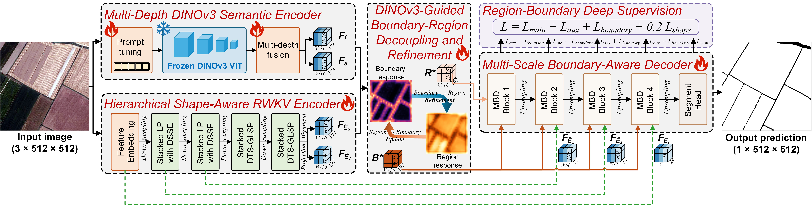

# DBANet

Model implementation for **DBANet: A dual-encoder boundary-aware network fusing foundation-model and task-specific features for generalizable agricultural parcel delineation**.

DBANet combines transferable semantic representations from a frozen satellite-pretrained DINOv3 backbone with hierarchical parcel geometry and boundary features from a complementary RWKV encoder.

**Release status:** This repository currently provides part of the code, including the model implementation and backbone initialization weights. The complete code, including data preprocessing, training, and evaluation pipelines, will be released upon acceptance of the manuscript.



## Repository Contents

```text
DBANET/
├── DBANet.py
├── ikan.py
├── rwkv_unet.py
├── cuda/
│   ├── wkv_cuda.cu
│   └── wkv_op.cpp
├── weights/
│   ├── dinov3_vitl16_sat493m.safetensors
│   ├── net_B.pth
│   ├── SHA256SUMS
│   ├── DINOV3_LICENSE.md
│   └── RWKV_WEIGHTS_LICENSE.txt
├── requirements.txt
├── THIRD_PARTY_RWKV_LICENSE
├── THIRD_PARTY_KAN_LICENSE
├── overall.png
└── README.md
```

The implementation uses local KAN and RWKV modules and does not require other directories from the research workspace.

## Requirements

- Python 3.10 or later.
- PyTorch, `timm`, `safetensors`, and `ninja` (see `requirements.txt`).
- A CUDA-capable GPU, a compatible CUDA toolkit, and a C++ compiler for compiling the WKV extension during the first CUDA run.

Ensure `CUDA_HOME` points to the installed CUDA toolkit. Validation used Python 3.13, PyTorch 2.10.0+cu128, timm 1.0.22, and CUDA 12.8 on an NVIDIA RTX 5090 D. Pretrained 512 × 512 inference and training backpropagation passed, including frozen-backbone and visual-prompt gradient checks.

Install PyTorch for your CUDA environment, then install the remaining dependencies:

```bash
pip install -r requirements.txt
```

## Pretrained Weights

The following checkpoints initialize the two backbones; they are **not trained DBANet checkpoints**.

| Backbone | File in `weights/` | Size | Upstream source |
|---|---|---:|---|
| DINOv3 ViT-L/16, SAT-493M | `dinov3_vitl16_sat493m.safetensors` | 1.21 GB | [timm DINOv3 model card](https://huggingface.co/timm/vit_large_patch16_dinov3.sat493m) · [Download](https://huggingface.co/timm/vit_large_patch16_dinov3.sat493m/resolve/main/model.safetensors) |
| RWKV-UNet-B encoder | `net_B.pth` | 97.02 MB | [RWKV-UNet](https://github.com/juntaoJianggavin/RWKV-UNet) · [Checkpoint mirror](https://huggingface.co/FengheTan9/U-Stone/resolve/main/net_B.pth) |

Sizes use decimal units. The DINOv3 file is the timm-compatible conversion of the satellite-pretrained Meta checkpoint, renamed locally. Original Meta-format `.pth` files cannot be substituted directly. DINOv3 weights are distributed under the included [DINOv3 license](weights/DINOV3_LICENSE.md); the RWKV checkpoint mirror declares [Apache 2.0](weights/RWKV_WEIGHTS_LICENSE.txt). The adapted RWKV and KAN source components retain their respective license notices.

With pretrained initialization enabled, the model first searches the `weights/` directory beside `DBANet.py`. If the files are absent, it uses the upstream download mechanisms. An explicitly supplied `--pretrained-dir` requires both local files and enables offline initialization. Some upstream RWKV attention entries are omitted by the HSRE configuration; all retained encoder entries must load successfully.

Verify the local files from the `weights/` directory with `sha256sum -c SHA256SUMS`. Large weight files require Git LFS or release attachments when publishing on GitHub. If downloaded as release attachments, place them in `weights/` using the filenames above.

## Quick Check

Run commands from this directory. Check model wiring on CPU with a small synthetic input:

```bash
python DBANet.py --image-size 64 --device cpu --aux
```

Check offline backbone initialization:

```bash
python DBANet.py --image-size 64 --device cpu --pretrained-dir weights --aux
```

CPU mode provides a small-input WKV fallback and uses the experimental MLP fallback in place of GPU KAN blocks. It is intended for structural checks and does not reproduce the CUDA model numerically.

Run the manuscript input configuration on CUDA with pretrained backbone initialization:

```bash
python DBANet.py --image-size 512 --device cuda --pretrained-dir weights
```

These commands use synthetic inputs to check execution; pretrained backbone initialization alone does not yield the trained parcel delineation model. CUDA inputs of 128, 256, or 512 pixels per side meet the bundled WKV kernel constraints; the small 64-pixel check is for CPU only.

## Checkpoint Loading

For a trained DBANet checkpoint, use:

```bash
python DBANet.py --image-size 512 --device cuda --checkpoint /path/to/best_model_checkpoint.pth
```

Checkpoints are loaded strictly. Direct state dictionaries and dictionaries containing `model_state_dict`, `state_dict`, `model`, or `net` are supported. Trained DBANet checkpoints are not included in this partial release.

## Datasets

The five agricultural datasets support parcel delineation and transfer evaluations. WHU and MASS are used for cross-task applicability experiments with supervised training on building labels.

| Dataset used in the manuscript | Original dataset or download page | Reference |
|---|---|---|
| AI4Orthos (AI4Boundaries orthophotos) | [JRC Open Data Catalogue](https://data.europa.eu/89h/0e79ce5d-e4c8-4721-8773-59a4acf2c9c9) | d'Andrimont et al. (2023) [1] |
| FGFD (Fine-Grained Farmland Dataset) | [Official dataset links](https://github.com/Henryjiepanli/DBBANet) | Li et al. (2025) [2] |
| CCPTD (China's Crop Parcel Training Dataset) | [Zenodo](https://zenodo.org/records/16595511) | Lu et al. (2025) [3] |
| AI4Small (AI4SmallFarms) | [DANS dataset](https://doi.org/10.17026/dans-xy6-ngg6) | Persello et al. (2023) [4] |
| GTPBD (Global Terraced Parcel and Boundary Dataset) | [Dataset download](https://huggingface.co/datasets/wxqzzw/GTD) · [Official repository](https://github.com/Z-ZW-WXQ/GTPBD) | Zhang et al. (2025) [5] |
| WHU Building Dataset (aerial imagery) | [Official dataset page](https://study.rsgis.whu.edu.cn/pages/download/building_dataset.html) | Ji et al. (2019) [6] |
| MASS (Massachusetts Buildings Dataset) | [Original images and labels](https://www.cs.utoronto.ca/~vmnih/data/) | Mnih (2013) [7] |

The links point to the original datasets. Dataset subsets, preprocessing, and evaluation splits follow the manuscript; processed copies are not included in this release. Please cite the original dataset publications when using the data.

## References

[1] d'Andrimont, R., Claverie, M., Kempeneers, P., Muraro, D., Yordanov, M., Peressutti, D., Batič, M., and Waldner, F. (2023). AI4Boundaries: An open AI-ready dataset to map field boundaries with Sentinel-2 and aerial photography. *Earth System Science Data*, 15, 317–329. [DOI](https://doi.org/10.5194/essd-15-317-2023).

[2] Li, J., Wei, Y., Wei, T., and He, W. (2025). A comprehensive deep-learning framework for fine-grained farmland mapping from high-resolution images. *IEEE Transactions on Geoscience and Remote Sensing*, 63, 1–15. [DOI](https://doi.org/10.1109/TGRS.2024.3515157).

[3] Lu, R., Liao, R., Meng, R., Hu, Y., Zhao, Y., Guo, Y., Zhang, Y., Shi, Z., and Ye, S. (2025). Strategic sampling for training a semantic segmentation model in operational mapping: Case studies on cropland parcel extraction. *Remote Sensing of Environment*, 331, 115034. [DOI](https://doi.org/10.1016/j.rse.2025.115034).

[4] Persello, C., Grift, J., Fan, X., Paris, C., Hänsch, R., Koeva, M., and Nelson, A. (2023). AI4SmallFarms: A dataset for crop field delineation in Southeast Asian smallholder farms. *IEEE Geoscience and Remote Sensing Letters*, 20, 2505705. [DOI](https://doi.org/10.1109/LGRS.2023.3323095).

[5] Zhang, Z., Ye, Z., Wen, Y., Yuan, S., Fu, H., Huang, J., and Zheng, J. (2025). GTPBD: A fine-grained global terraced parcel and boundary dataset. *Advances in Neural Information Processing Systems*, Datasets and Benchmarks Track. [Paper](https://arxiv.org/abs/2507.14697).

[6] Ji, S., Wei, S., and Lu, M. (2019). Fully convolutional networks for multisource building extraction from an open aerial and satellite imagery data set. *IEEE Transactions on Geoscience and Remote Sensing*, 57, 574–586. [DOI](https://doi.org/10.1109/TGRS.2018.2858817).

[7] Mnih, V. (2013). *Machine Learning for Aerial Image Labeling*. PhD dissertation, University of Toronto. [Dataset and citation](https://www.cs.utoronto.ca/~vmnih/data/).

Backbone sources: [DINOv3](https://github.com/facebookresearch/dinov3) and [RWKV-UNet](https://arxiv.org/abs/2501.08458). The KAN helper is adapted from [Efficient-KAN-in-Chinese](https://github.com/lgy112112/Efficient-KAN-in-Chinese).
